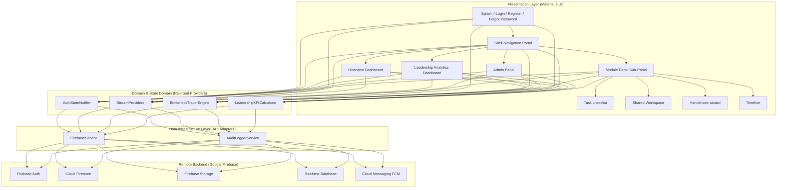
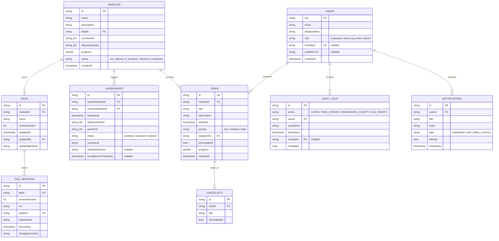

# 🧊 GLASSBOARD – ORG WORKFLOW & BOTTLENECK TRACKING PLATFORM

GlassBoard is a transparent, inter-department dependency and workflow management platform designed to solve the critical problem of tracking and auditing cross-department handoff delays.

By enforcing a verifiable **Digital Handshake System** between modules, GlassBoard introduces complete transparency, trace-level accountability, and immutable audit logs that point out the exact root cause of delays, unblocking downstream pipelines.

---

## 🏗️ System Architecture Diagram

GlassBoard follows **Clean Architecture** combined with a **Feature-Based Structure**. This decouples UI presentation, reactive business state engines, and storage services.



---

## 🗄️ Database Schema Diagram (ERD)

This entity-relationship diagram illustrates the connections and constraints between Firestore tables and Realtime Database paths.



---

## 🔄 User Flow Diagram (Digital Handshake System)

This represents the primary transaction process governing a work handoff between two departments (e.g., Design Studio ➔ Software Development).

```mermaid
sequenceFlow
    loop Core Checklist Pipeline
        Sender Lead->>Tasks Panel: Mark checklist items as complete
        Tasks Panel-->>Module Tracker: Re-calculate progress percentage
    end
    
    rect rgba(99, 102, 241, 0.1)
        Note over Sender Lead: Handoff Verification Wizard
        Sender Lead->>Shared Workspace: Upload final specs (registers Version 1)
        Sender Lead->>Handshake Wizard: Input delivery comments, Figma/APK URL & attach File IDs
        Sender Lead->>Firebase: Create Handshake request (status: pending)
        Firebase-->>Audit Logs: Write immutable log (HANDSHAKE_CREATE)
    end
    
    rect rgba(245, 158, 11, 0.15)
        Firebase-->>Receiver Lead: Push real-time FCM Alert & block downstream nodes
        Receiver Lead->>Handshake review: Inspect uploaded files and verification proofs
        
        alt Verification PASS
            Receiver Lead->>Handoff Gate: Tap ACCEPT & SIGN
            Handoff Gate->>Firebase: Update Handshake status: accepted
            Handoff Gate->>Firebase: Update acceptance timestamp
            Handoff Gate->>Audit Logs: Write immutable log (HANDSHAKE_ACCEPT)
            Handoff Gate-->>Module Tracker: Unblock downstream modules (status: in_progress)
        else Verification FAIL
            Receiver Lead->>Handoff Gate: Tap REJECT & INPUT COMMENTARY
            Handoff Gate->>Firebase: Update Handshake status: rejected
            Handoff Gate->>Firebase: Store rejectionReason
            Handoff Gate->>Audit Logs: Write immutable log (HANDSHAKE_REJECT)
            Handoff Gate-->>Sender Lead: Alert sender to modify files and resubmit
        end
    end
```

---

## 🛠️ Setup & Running Guide

Since this codebase features an intelligent **dual-mode engine**, you can run and demonstrate the entire application immediately **without needing active internet or pre-configured Firebase projects**! If no Firebase context is active, it automatically spins up a high-fidelity local memory repository populated with four logical departments (Design, Development, QA, and Deployment) and relative logs.

### Step 1: Initialize Flutter Workspace
If native folder structures (like `android` or `ios`) are missing, run the standard Flutter compiler initialization in your workspace directory:
```bash
flutter create .
```
This automatically structures your platform directories (Java/Kotlin, Swift/Objective-C configurations) without modifying the `lib` folder or `pubspec.yaml`.

### Step 2: Fetch System Dependencies
```bash
flutter pub get
```

### Step 3: Run the Application
Start your simulator or attach your physical device and run:
```bash
flutter run
```

---

## ☁️ Firebase Connection Guide (Optional)

Once your academic or corporate review requires live synchronization, connecting your Firebase suite is simple:

1. **Activate FlutterFire CLI:**
   ```bash
   npm install -g firebase-tools
   firebase login
   dart pub global activate flutterfire_cli
   ```
2. **Configure project endpoints:**
   Run from your project root:
   ```bash
   flutterfire configure
   ```
   Follow the prompt to link your Apple and Android packages to your Firebase project. This automatically generates a `lib/firebase_options.dart` file.
3. **Firestore Indexes:**
   Add single-field composite indexes on Firestore if you filter queries across multiple properties (e.g. tasks filtered by `moduleId` and ordered by `dueDate`).

---

## 🔒 Production Security Rules Configuration
Drop the provided [firestore.rules](file:///c:/Users/ayush/Documents/GLASS%20BOARD%2001/firestore.rules) into your Firebase console or deploy it via Firebase CLI:
```bash
firebase deploy --only firestore:rules
```
This enforces Role-Based Access Controls (RBAC), ensuring employees can only edit their own tasks, Leads can only review handshakes directed to their departments, and Org Heads are strictly locked to global read-only audits.

---

## 🧪 Testing Plan

To verify the GlassBoard system, execute the following testing strategies:

### 1. Verification of Role-Based Security (RBAC)
- **Employee Login Test:** Log in as John (`john@glassboard.com`). Try to create a module or assign leads. The UI should hide these action buttons, and writing directly via Firestore should be rejected by our security rules.
- **Lead Login Test:** Log in as Ayush (`ayush@glassboard.com`). Create a task, check off checklist items, and create a Handshake towards QA. These write transactions should complete successfully.
- **Org Head Login Test:** Log in as Dr. Arthur (`director@glassboard.com`). Access the audit feed and bottleneck charts. Verify that all edit widgets are invisible.
- **Admin Login Test:** Log in as Elena (`admin@glassboard.com`). Promote a member's role or initialize a new module. Verify that all features are fully unlocked.

### 2. Verification of Dependency Engine & Root Cause Analysis
- Reset mock data using the **Refresh** button in the AppBar.
- Observe that the **Quality Assurance** and **Release Operations** modules are currently showing **Blocked** on the dashboard.
- Observe the flashing warning banner: **"CRITICAL PIPELINE DELAY DETECTED: Software Development"**.
- Log in as Ayush (`ayush@glassboard.com` - Lead Dev) and complete the pending Dev checklist tasks.
- Initiate a Handoff to QA attaching your verification links.
- Log in as Clara (`clara@glassboard.com` - Lead QA) and accept the handshake signature.
- Verify that the **Quality Assurance** module automatically changes status to **In Progress**, unblocking the pipeline, and the warning banner disappears.
